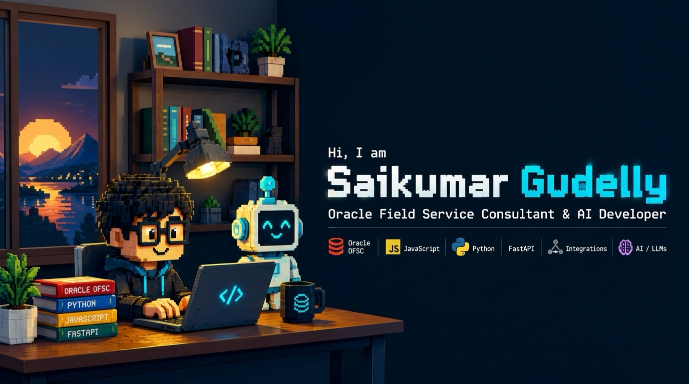

# Hi there, I'm Saikumar Gudelly 👋

### Oracle Cloud & Siebel Techno-Functional Consultant | AI Engineer

---

### 🚀 About Me

- 💼 **Current Role**: Oracle OFSC & Siebel Consultant at **Infosys** (serving American Electric Power)
- 🏢 **Previous Experience**: Siebel CRM Support & Development Engineer at **Tata Consultancy Services** (Canon Global)
- 🤖 **AI & Engineering**: Deep into autonomous agent systems, FastAPI protocols, and LLM applications
- 🎓 **Certifications**: Oracle Cloud Infrastructure 2024 Generative AI Certified Professional & OCI Foundations Associate
- 📍 **Location**: Hyderabad, India

---

### 🛠️ Tech Stack & Tools

  <!-- Languages -->
  
  
  
  
  
  
  <!-- Oracle & Enterprise -->
  
  
  
  
  <!-- APIs & Database -->
  
  
  
  
  

---

### 🌟 Featured Projects

| Project | Description | Tech Stack |
| :--- | :--- | :--- |
| 🤖 [**fastapi-a2a**](https://github.com/saikumargudelly/fastapi-a2a) | Peer-to-peer Agent-to-Agent communication network enabling autonomous agent coordination. | `FastAPI` `Python` `AI Agents` |
| 📡 [**repodar**](https://github.com/saikumargudelly/repodar) | Real-time GitHub intelligence platform evaluating code health, trends, and sustainability. | `Next.js` `FastAPI` `PostgreSQL` |
| 💰 [**chanakya-ai**](https://github.com/saikumargudelly/chanakya-ai) | AI-powered personal financial coach offering smart budgeting recommendations. | `Python` `LLM` `FastAPI` |
| 📦 [**OFSC-Postman-Collection**](https://github.com/saikumargudelly) | Comprehensive 200+ endpoint suite for Oracle Field Service Cloud REST API testing. | `REST APIs` `Postman` `JSON` |

---

### 📊 GitHub Stats

  <!-- Row 1: Overview Stats & Streak Stats -->
  
  

    

  <!-- Row 2: Top Languages & Extended Stats -->
  
  

---

  Designed with ❤️ for <a href="https://github.com/saikumargudelly">Saikumar Gudelly</a>

